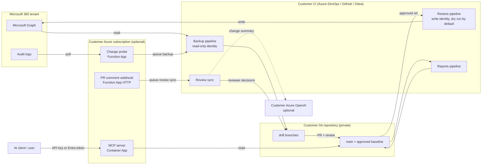

# ASTRAL security overview

This folder is for security reviewers. It describes what ASTRAL does, what it can access, where its secrets live,
and what is known to be weak. We list known limitations openly. If you find something that is not listed here,
please report it as described in [SECURITY.md](../../SECURITY.md).

| Document | Contents |
|---|---|
| This page | Architecture, data, identities and permissions, network exposure, secrets, supply chain, history, known limitations |
| [controls-and-evidence.md](./controls-and-evidence.md) | Each security control, the code that enforces it, and the test that proves it |
| [audit-preparation.md](./audit-preparation.md) | Evidence an operator collects from a deployment, scanner commands, credential rotation |

The statements on this page apply to release `v1.5.1` and later.

## What ASTRAL is

ASTRAL exports Microsoft Intune and Entra ID configuration into a Git repository on a schedule. Changes ("drift")
are committed to a drift branch and reviewed in a rolling pull request. Reviewers accept or reject each change. A
separate restore pipeline can write an approved baseline back to the tenant.

ASTRAL is source code that the customer deploys in their own Azure DevOps project, GitHub Enterprise or Gitea
instance, and Azure subscription. There is no hosted service and no data is sent to the maintainers.

## Architecture



The backup, review and restore pipelines have no inbound endpoint. The optional Azure components add two inbound
HTTPS endpoints (the MCP server and the PR comment webhook), described under [Network exposure](#network-exposure).

## Data handled

| Data | Examples | Stored in |
|---|---|---|
| Intune configuration | Compliance policies, configuration profiles, Settings Catalog, apps, scripts (including script bodies), filters, scope tags, assignments | `tenant-state/intune/` in the customer repository |
| Entra configuration | Conditional Access, named locations, authentication strengths, app registrations and enterprise applications (including credential metadata: key IDs, names, dates, never secret values) | `tenant-state/entra/` |
| Entra identity data | Security groups referenced by Conditional Access with member counts; full member lists for groups listed in `ENTRA_WATCH_GROUPS_CSV` and for role-assignable groups; directory role assignments (permanent and PIM-eligible) with principal names; PIM, authentication methods, cross-tenant, Identity Protection and security-default policies | `tenant-state/entra/` |
| Reports | Assignment, object, app and per-setting inventories (CSV/Markdown) | `tenant-state/reports/` |
| Review metadata | PR descriptions, threads, `/accept` and `/reject` comments | The forge (Azure DevOps, GitHub, Gitea) |
| Probe state | Debouncer timestamps and state | Azure Table Storage |
| AI summary payload (optional) | Changed file paths (which contain policy names), operation, risk label, a semantic description of changed settings with old and new values, fingerprints | Sent to the customer's Azure OpenAI deployment; not stored by ASTRAL |

Sensitivity:

- **Personal data.** Group member lists and role assignments contain user display names and UPNs. Policies can
  contain administrator email addresses. Treat the repository as containing personal data.
- **Secrets inside exports.** If administrators embed secrets in Intune scripts or custom payloads, the export
  contains them. ASTRAL does not detect or redact them.
- **Build logs** contain policy names, change summaries and Graph error messages. Treat them like the repository.

The repository that holds `tenant-state/` must be private, with a restricted collaborator list and no public forks.
The public `cqrenet/astral` repository contains only placeholder files under `tenant-state/`.

## Identities and permissions

### Microsoft Graph

| Identity | Permissions (application) | Used by |
|---|---|---|
| Backup identity | `Device.Read.All`, `DeviceManagementApps.Read.All`, `DeviceManagementConfiguration.Read.All`, `DeviceManagementManagedDevices.Read.All`, `DeviceManagementRBAC.Read.All`, `DeviceManagementScripts.Read.All`, `DeviceManagementServiceConfig.Read.All`, `Group.Read.All`, `Policy.Read.All`, `Policy.Read.ConditionalAccess`, `Policy.Read.DeviceConfiguration`, `User.Read.All`, `Application.Read.All`, `RoleManagement.Read.Directory`. Optional: `RoleEligibilitySchedule.Read.Directory`, `RoleManagementPolicy.Read.Directory`, `AdministrativeUnit.Read.All` (or `Directory.Read.All`), `AuditLog.Read.All` | Backup and reports |
| Restore identity | `DeviceManagementApps.ReadWrite.All`, `DeviceManagementConfiguration.ReadWrite.All`, `DeviceManagementManagedDevices.ReadWrite.All`, `DeviceManagementRBAC.ReadWrite.All`, `DeviceManagementScripts.ReadWrite.All`, `DeviceManagementServiceConfig.ReadWrite.All`, `Group.Read.All`; with Entra restore also `Policy.Read.All`, `Policy.ReadWrite.ConditionalAccess` | Restore only |
| Change probe app | `AuditLog.Read.All`, `DeviceManagementApps.Read.All`, `DeviceManagementConfiguration.Read.All`, `DeviceManagementManagedDevices.Read.All`, `DeviceManagementScripts.Read.All`, `DeviceManagementServiceConfig.Read.All` | Function App (client secret) |

The Azure DevOps pipelines decode the Graph token and stop before any Graph call when a required role is missing;
the restore pipeline checks for its write roles before it runs. The GitHub and Gitea workflows log a warning for a
missing role and continue.

Some identity-export categories log a message and skip when Graph denies access or the tenant lacks the licence
(PIM-eligible assignments, PIM policies, Identity Protection policies, external identities policy). A missing
permission therefore shows up as a missing category, not as a failed run. Check the backup log after granting
permissions.

Use separate identities for backup and restore. In Azure DevOps both pipelines read the service connection from
the same variable, `SERVICE_CONNECTION_NAME`, so by default they use the same identity and the backup pipeline
holds write permissions. Give the restore pipeline its own service connection (for example through a separate
variable group) with approval checks. The GitHub workflows already keep the write identity in a separate
environment.

### Entra app registration created by `deploy/provision.ps1`

The provisioning script creates **one** app registration that serves two purposes:

1. The change probe signs in with it (client secret, valid one year) and holds the Graph permissions above.
2. MCP clients sign users in to it. It exposes a delegated `user_impersonation` scope. The script grants admin
   consent for that scope for all users, sets the app as a public client, and registers `http://localhost` and
   `https://claude.ai/api/mcp/auth_callback` as redirect URIs.

Since `v1.5.1` the script sets **assignment required** on the enterprise application. Only users and groups that an
administrator assigns can obtain a token for the MCP server. Earlier releases did not set it, so every user in the
tenant could sign in to the MCP server and read the exported tenant state. Re-run `provision.ps1` or set
*Assignment required* manually on deployments made before `v1.5.1`.

A leaked probe client secret gives Graph read access with the permissions above. It does not give MCP access,
because the MCP server requires a delegated user token with the `user_impersonation` scope. Combining both roles in
one app is a known weakness, listed below.

### Azure DevOps, GitHub and Gitea

| Identity | Permissions | Notes |
|---|---|---|
| Pipeline identity (`System.AccessToken`) | Contribute, create branch, **force push**, create and update pull requests, optionally create tag; *View builds* and *Queue builds* on the restore pipeline when auto-remediation is on | Force push is needed for the drift branches. Grant it on `drift/*` only and deny it on `main`. |
| Change probe PAT (`ADO_TOKEN`) | Build (Read & Execute) | Queues the backup and review-sync pipelines. A PAT is tied to the user who created it. |
| MCP PAT | Code (Read) | Reads `tenant-state/`. Since `v1.4.1` separate from the probe PAT. |
| GitHub/Gitea workflows | Backup, review and probe: `contents: write`, `pull-requests: write`, `actions: write` (to dispatch other workflows), `id-token: write` where OIDC is used. Restore: `contents: read`, `id-token: write`, in a protected environment that holds the write-capable identity | Graph auth uses managed identity, GitHub OIDC federation, a client certificate, or a client secret (`GRAPH_AUTH_METHOD`) |

Reviewer decisions (`/reject`, `/accept`, Reject votes) count only from accounts listed in
`PR_DECISION_ALLOWED_REVIEWERS`. An empty list means no decision is applied. Anyone who can edit that variable can
authorize themselves, so restrict write access to the variable group.

## Network exposure

| Endpoint | Exposure | Authentication |
|---|---|---|
| MCP server (`/sse`, `/messages/`) | Public HTTPS by default. `-McpIngress internal` removes the public endpoint. | API key (constant-time compare) **or** Entra bearer token (signature, exact issuer, tenant, audience, `user_impersonation` scope). The server refuses to start without one of them. Host header allowlist (DNS rebinding protection). `/health` and the OAuth discovery document are unauthenticated. |
| PR comment webhook (`/api/pr_comment_webhook`) | Public HTTPS (Function App, `authLevel: anonymous`) | HTTP Basic with a shared secret, compared in constant time; any username. Since `v1.5.1` it rejects all requests when no secret is set. A valid request only queues the review-sync pipeline; reviewer authorization still happens in that pipeline. |
| Change probe timer and queue functions | No HTTP trigger | Not applicable |

Outbound connections: Microsoft Graph and the Entra token endpoint, the forge API, Azure Storage, the optional Azure
OpenAI endpoint, and package registries during pipeline runs (PyPI, npm, PowerShell Gallery, Debian/Ubuntu
mirrors for PDF rendering).

## Secrets

| Secret | Created by | Stored in | Lifetime | Notes |
|---|---|---|---|---|
| Graph access tokens (pipelines) | Pipeline at run time | Secret pipeline variable or masked step output | About one hour | Claims and roles are logged, the token is not |
| Probe client secret | `provision.ps1` | Function App setting `PROBE_APP_SECRET` | One year | Printed once on the operator's console at the end of provisioning |
| Probe PAT | Operator | Function App setting `ADO_TOKEN` | Set by the operator | User-bound |
| MCP PAT | Operator | Container App secret `ado-token` | Set by the operator | User-bound |
| MCP API key | `provision.ps1` (32 random bytes) | Container App secret `mcp-api-key` | No expiry | Static shared bearer secret, printed once. Anyone who has it can read tenant state through MCP. Always configured by the script. |
| Webhook secret | `provision.ps1` (24 random bytes) | Function App setting `WEBHOOK_SECRET` and the ADO service hook | No expiry | Printed once |
| Storage account key | Azure | Function App setting `AzureWebJobsStorage` | Until rotated | Needed by the Functions runtime |
| Function package SAS URL | `provision.ps1` | Function App setting `WEBSITE_RUN_FROM_PACKAGE` | Ten years, read-only, one blob | Exposes the code package, which contains no secrets |
| Azure OpenAI key | Operator | Secret pipeline variable | Set by the operator | Optional |
| GitHub/Gitea Graph credential | Operator | Environment secret (certificate or client secret), or none with OIDC/managed identity | Set by the operator | |

Command lines: ASTRAL's own scripts read Graph and forge tokens from the environment. IntuneCD accepts the Graph
token only as a command-line argument, so during an Intune backup or restore the token is visible to other
processes on the same agent for the length of that step. Use dedicated or ephemeral agents.
`provision.ps1` passes Function App settings through a private temporary file, not the `az` command line. It still
passes the Container App secret values on the `az` command line once, on the operator's machine. Run it from a
trusted workstation or Azure Cloud Shell. It saves non-secret defaults to `.astral-deploy.json` (gitignored).

## Optional Azure OpenAI summaries

PR summaries can include a narrative written by the customer's own Azure OpenAI deployment. This is off unless
`ENABLE_PR_AI_SUMMARY=true` and an endpoint, deployment and key are configured. Before `v1.5.1` the shared Azure
DevOps variable template set the flag to `true`, which overrode a `false` in the customer's variable group, so the
summary ran whenever an endpoint and key were configured.

The payload is described in [Data handled](#data-handled) and is limited by `PR_AI_PAYLOAD_MAX_BYTES` (default
120 KB). The model has no credentials for Graph or the forge. Its output is advisory text in the PR description; it
cannot approve, reject, merge or restore anything. Model output is only shortened to fit, not otherwise validated.
Policy names and setting values come from the tenant, so a crafted policy could try to steer the narrative (prompt
injection). The deterministic change and risk summary next to it is produced without the model; reviewers should
rely on that and on the diff.

## Supply chain

Pinned and verified:

- MCP server and change probe dependencies are hash-locked (`infra/*/requirements.txt`, generated from
  `requirements.in` with `uv`). The MCP image installs with `--require-hashes` on a digest-pinned base image.
- GitHub Actions are pinned to commit SHAs (enforced by a test). Gitea workflows use no marketplace actions.
- Dependabot proposes updates for Actions, the locked Python dependencies and the Docker base image.
- CI on every push and pull request runs the unit tests, `shellcheck`, `bandit` (high-severity gate), `pip-audit`
  on both lock files, and a TruffleHog secret scan. `pip-audit` also runs weekly.

Installed at run time by version, not by hash:

- `IntuneCD==2.6.0` (third-party, does the Intune export and restore) and its dependencies from PyPI. The restore
  pipeline runs it with Graph write permissions.
- `PyYAML==6.0.3`.
- `md-to-pdf` from npm (global install by version, without a lock file) and the Chromium it downloads, for the
  optional HTML/PDF documentation.
- `Microsoft.Graph.DeviceManagement.Administration` 2.x from the PowerShell Gallery.
- Debian/Ubuntu packages for PDF rendering.
- CI tools (`bandit`, `pip-audit`, `shellcheck-py`) are not pinned. They run only in the public repository's CI,
  with read-only repository permissions.

Customers who forbid run-time downloads should bake these into their agent image or use an internal mirror.

Upstream updates: `deploy/update-from-upstream.yml` pulls a tagged release from this public repository into the
customer repository. The code then runs in the customer's pipelines with their credentials. Release tags are
protected against deletion and moving. `main` requires a reviewed pull request and passing CI, but repository
administrators can bypass that rule. Releases and commits are **not signed**.
Customers should update to a release tag, run the pipeline in dry-run mode first, and review the diff.

## Repository history

- The public repository was created on 1 June 2026 and filled from sanitized snapshots of a private development
  repository. Its history contains 24 snapshot commits titled "Sync from dev @ <hash>". Since `v1.4.0`
  development happens in this repository.
- A full-history scan of the public repository (all branches and tags, TruffleHog 3.99.8, 12 November 2026) found
  no verified or unverified secrets and no tenant export files.
- History contains the tenant ID of the maintainers' own tenant in an earlier release checklist (from 2 June 2026
  until `v1.4.0`). A tenant ID is an identifier, not a credential.
- History contains earlier versions of the security review documents, which this folder replaces. Pricing and
  support terms were never committed to the public repository.
- History is not rewritten, so these items remain visible in old commits.

## Testing and its limits

The test suite (`python3 -m unittest discover -s tests`) covers the Python scripts, the shell and PowerShell
pipeline helpers, structural rules for all pipeline definitions, the MCP server's authentication, and a smoke test
that starts the real MCP server. It does not cover:

- calls to a real tenant, Azure DevOps or Azure (Graph and forge APIs are stubbed),
- an end-to-end restore (the restore guards are tested; IntuneCD writing to a tenant is not),
- `deploy/provision.ps1` against Azure (only parsing and package contents are tested),
- the behaviour of the pipelines on a real agent (only their structure is tested).

## Known limitations

| # | Limitation | Impact | Recommendation |
|---|---|---|---|
| 1 | Azure DevOps backup and restore use the same service connection unless the operator separates them | The backup pipeline, which runs on a schedule, holds Graph write permissions | Separate service connections; approval and branch checks on the restore connection |
| 2 | One Entra app is both the change probe identity (Graph application permissions, client secret) and the MCP OAuth app | A misconfiguration of one purpose affects the other; the app has a client secret and is a public client | Use a separate app registration for MCP without Graph permissions or secrets |
| 3 | The MCP API key is a static shared secret without expiry, always configured by `provision.ps1` | Anyone with the key can read tenant state through MCP | Use Entra authentication only; remove `MCP_API_KEY` from the Container App if you do not need it; rotate it otherwise |
| 4 | The MCP server and the webhook are public endpoints by default | Exposed to internet scanning and password guessing; protected only by application-level authentication | Use `-McpIngress internal` where possible; add Container Apps IP restrictions or Functions access restrictions |
| 5 | Function App secrets are plain app settings; the package SAS URL is valid for ten years | Readable by anyone with read access to the app configuration | Use Key Vault references and managed identity for storage; restrict Azure RBAC on the resource group |
| 6 | PATs are user-bound and long-lived | A PAT leak acts as that user | Create PATs from a low-privilege service account, set short expiry, rotate |
| 7 | The pipeline identity holds force-push permission | Without a deny on `main` it could rewrite the baseline | Scope force push to `drift/*`; protect `main` with branch policies |
| 8 | A user who can edit pipeline YAML on a branch can change what the restore pipeline runs | Bypasses the restore ref guard | Add Branch control and Approval checks to the restore service connection; restrict *Queue builds* and *Edit pipeline* |
| 9 | Tenant exports can contain embedded secrets and personal data; no redaction | Repository readers see them | Private repository, restricted access, retention policy; review script hygiene before onboarding |
| 10 | Several identity-export categories skip silently on permission errors | Missing coverage is not obvious | Check backup logs after granting permissions |
| 11 | Run-time package downloads are pinned by version, not hash (see Supply chain) | A compromised upstream package runs with pipeline credentials | Internal mirror or pre-baked agent image |
| 12 | IntuneCD receives the Graph token as a command-line argument | Other processes on the same agent can read it while the step runs | Dedicated or ephemeral agents |
| 13 | Releases and commits are not signed | Customers rely on GitHub account and tag protection | Pin updates to release tags and review the diff |
| 14 | The change probe runs on the Linux Consumption plan (retired by Microsoft on 30 September 2028, Python 3.12 at most) | Platform end of life | Move to Flex Consumption before then |
| 15 | Bandit reports B310 (`urllib` URL open) in the HTTP helpers | None known: URLs are built from operator configuration, not tenant data | Accepted |

## Issues fixed during the 2026 internal review

These were found by the maintainers and fixed before this review. They are listed so that reviewers can verify the
fixes and check older deployments.

| Fixed in | Issue |
|---|---|
| `v1.4.0` | MCP Entra issuer was matched by substring instead of exactly |
| `v1.4.0` | Restore could validate a ref against a stale approved branch when a fetch failed (now fails closed) |
| `v1.4.0` | A failed IntuneCD restore without known error text was reported as success |
| `v1.4.0` | Probe and trigger credentials were passed on the child process command line |
| `v1.4.1` | MCP image pulls used the registry admin user; MCP shared the probe's PAT; the MCP clone token was on the command line |
| `v1.5.1` | PR comment webhook accepted every request when no secret was set, and rejected valid requests that used a username |
| `v1.5.1` | MCP enterprise application did not require assignment, so any tenant user could sign in |
| `v1.5.1` | `ENABLE_PR_AI_SUMMARY=false` in the variable group was overridden by the shared template |

## Recommended conservative configuration

```text
ENABLE_PR_AI_SUMMARY=false            # until the payload and Azure OpenAI deployment are approved
AUTO_REMEDIATE_ON_PR_REJECTION=false
AUTO_REMEDIATE_AFTER_MERGE=false
AUTO_REMEDIATE_DRY_RUN=true
PR_DECISION_ALLOWED_REVIEWERS=<reviewer UPNs>
REQUIRE_CHANGE_TICKETS=true
```

Also: separate read-only backup and write-capable restore identities; restore queued manually with approval checks;
branch policies on `main`; explicit retention for repository, logs and artifacts; MCP with Entra authentication and
assigned users only.
